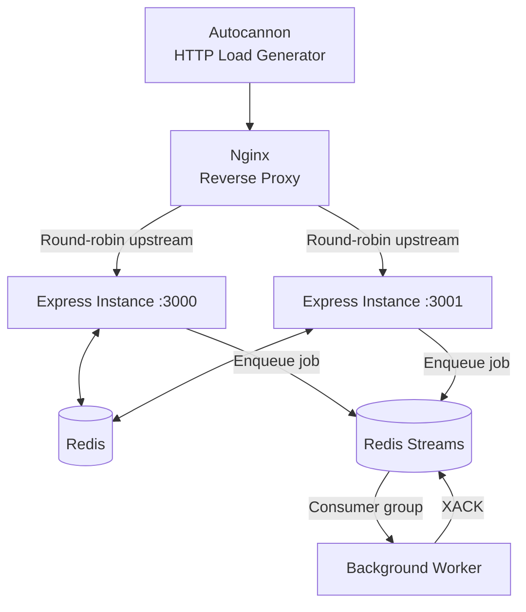

# Scaling Experiments

**A hands-on exploration of backend performance, caching, asynchronous processing, and load balancing.**

Experiments with Node.js, Express, Redis, Redis Streams, Nginx, and Autocannon to understand how backend components interact under concurrent HTTP traffic.

The focus is not on adding infrastructure for its own sake. It is on measuring behavior, investigating unexpected results, and building a practical understanding of backend scaling.

[Repository](https://github.com/Akash504-ai/scaling-experiments)

---

## Overview

What happens when a simple API starts receiving concurrent requests? Does adding another application instance improve throughput? How does caching affect request handling? What changes when a reverse proxy sits between the client and the application?

This repository explores these questions through a small, reproducible local environment.

The application starts with a Node.js and Express API, introduces Redis-backed caching and asynchronous job processing, and then places two application instances behind an Nginx reverse proxy.

The resulting system provides a practical environment for observing backend behavior instead of relying solely on architectural assumptions.

## Architecture



### How the components interact

| Component | Responsibility |
|---|---|
| Autocannon | Generates concurrent HTTP requests and measures performance. |
| Nginx | Acts as a reverse proxy and distributes requests across configured upstream servers. |
| Express | Handles incoming HTTP requests in two separate application processes. |
| Redis | Provides shared storage for cached responses. |
| Redis Streams | Stores jobs submitted for asynchronous processing. |
| Background worker | Consumes stream messages and acknowledges processed jobs. |

Both Express instances use the same application code and connect to the same Redis service. This allows the instances to share cache data and submit jobs to a common stream.

Nginx is configured with two upstream servers and uses its default round-robin selection behavior.

## Experiments

### 01 — HTTP load testing

Autocannon generates concurrent requests against the API. Throughput, latency, and errors provide a baseline for examining how the service behaves under load.

### 02 — Redis response caching

The `/data` endpoint uses Redis to cache responses with a **30-second time-to-live (TTL)**.

This experiment explores how cached responses can reduce repeated application work and how cache expiration affects subsequent requests.

### 03 — Asynchronous job processing

The `POST /jobs` endpoint submits jobs to a Redis Stream instead of requiring the request handler to perform all processing synchronously.

A separate `worker.js` process consumes messages through a Redis consumer group and acknowledges successfully processed messages using `XACK`.

This separates job submission from background execution and provides a starting point for exploring queues, consumer groups, and message acknowledgement.

### 04 — Multiple application instances

The Express application runs on ports `3000` and `3001`. Nginx forwards incoming requests to the configured upstream instances.

The experiment examines whether distributing requests across multiple instances translates into improved performance in a local environment.

## Benchmark Results

The following measurements were observed during local load tests.

**Test configuration:** 50 concurrent connections, 20-second duration.

| Configuration | Throughput | Reported errors |
|---|---:|---:|
| Direct Express instance (`:3001`) | ~20,058 req/s | Not recorded here |
| Nginx with two Express instances | ~5,165 req/s | 79 |

These results are observations from a development machine, not production performance claims.

The Nginx configuration produced lower measured throughput in this test. This does not establish that Nginx or load balancing inherently reduces performance. The result needs further investigation, particularly because the proxy run reported errors.

Potential areas to investigate include proxy and connection-handling overhead, host resource usage, error details, and consistency between benchmark runs.

**The main takeaway:** adding another application instance does not automatically guarantee higher throughput. Performance needs to be measured under controlled and comparable conditions.

## Technology Stack

| Technology | Role |
|---|---|
| JavaScript | Application logic |
| Node.js | JavaScript runtime |
| Express | HTTP server and API routes |
| Redis | Response cache |
| Redis Streams | Background job queue |
| Nginx | Reverse proxy and load balancing |
| Docker | Local Redis and Nginx services |
| Autocannon | HTTP benchmarking |

## Getting Started

### Prerequisites

Install the following:

- Git
- Node.js and npm
- Docker Desktop

The commands below assume Windows Command Prompt where explicitly noted. The Nginx container configuration also assumes that both Express instances run directly on the host machine.

### 1. Clone the repository

```bash
git clone https://github.com/Akash504-ai/scaling-experiments.git
cd scaling-experiments
```

### 2. Install dependencies

```bash
npm install
```

### 3. Start Redis

```bash
docker run -d --name redis-lab -p 6379:6379 redis:7-alpine
```

If the container already exists, start it instead:

```bash
docker start redis-lab
```

### 4. Start the Express instances

In the first terminal, run:

```bat
set PORT=3000 && npm run dev
```

In a second terminal, run:

```bat
set PORT=3001 && npm run dev
```

Ensure the project's `dev` script starts the Express application and that `server.js` reads the `PORT` environment variable.

### 5. Start the background worker

In another terminal:

```bash
node worker.js
```

Keep the worker running while testing background job processing.

### 6. Start Nginx

From the project directory in Windows Command Prompt:

```bat
docker run -d --name nginx-lab -p 8080:80 --add-host=host.docker.internal:host-gateway -v "%cd%/nginx.conf:/etc/nginx/nginx.conf:ro" nginx:alpine
```

Validate the configuration:

```bash
docker exec nginx-lab nginx -t
```

The configuration should reference the two host services at `host.docker.internal:3000` and `host.docker.internal:3001`.

### 7. Verify the setup

Direct application instances:

- `http://localhost:3000`
- `http://localhost:3001`

Through Nginx:

- `http://localhost:8080`

Use the `/data` endpoint to exercise the caching path and `POST /jobs` to exercise the background job path.

## Running Benchmarks

Use the same endpoint, connection count, duration, and machine conditions when comparing configurations.

### Direct Express

```bash
npx autocannon -c 50 -d 20 http://localhost:3001/
```

### Through Nginx

```bash
npx autocannon -c 50 -d 20 http://localhost:8080/
```

### Cached endpoint

```bash
npx autocannon -c 50 -d 20 http://localhost:3000/data
```

The cached endpoint measures a different request path from the root endpoint, so its results should be reported separately.

For more useful comparisons, record throughput, average latency, latency percentiles, error counts, and the exact test conditions. Repeat each test several times and compare the results rather than relying on a single run.

## Project Structure

```text
scaling-experiments/
├── nginx.conf
├── package.json
├── package-lock.json
├── server.js
├── worker.js
└── .gitignore
```

| File | Description |
|---|---|
| `server.js` | Express application and API endpoints. |
| `worker.js` | Background worker for Redis Stream messages. |
| `nginx.conf` | Nginx upstream and reverse proxy configuration. |
| `package.json` | Dependencies and npm scripts. |
| `package-lock.json` | Locked npm dependency versions. |
| `.gitignore` | Files excluded from version control. |

## Scope and Limitations

This repository is a local backend learning environment. It is not intended to be deployed as a production service in its current form.

- The benchmark results depend on the local machine, Docker networking, and test conditions.
- The observed Nginx test errors require investigation before drawing firm performance conclusions.
- Production concerns such as authentication, rate limiting, monitoring, graceful shutdown, and deployment orchestration are outside the current scope.
- Reliable background processing also requires careful handling of retries, failed messages, consumer recovery, and duplicate processing.
- No claim is made that the current setup is production-ready or that horizontal scaling has improved performance.

## Further Experiments

Possible directions for future investigation:

- Identify the cause of errors in the Nginx benchmark.
- Compare repeated runs with and without the reverse proxy.
- Measure latency percentiles and error rates alongside throughput.
- Compare cached and uncached endpoint behavior.
- Explore Redis Stream consumer recovery and failed-job handling.

These are potential experiments rather than implemented features.

## Purpose

The purpose of this repository is straightforward: build small backend experiments, observe their behavior, and understand the trade-offs behind common system design components.

The emphasis is on measured results and practical understanding, not on claiming scalability from the presence of a particular technology.

---

**Author:** [Akash504-ai](https://github.com/Akash504-ai)

**Repository:** [scaling-experiments](https://github.com/Akash504-ai/scaling-experiments)
